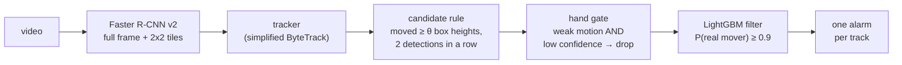

# Who Moves? — alarms for moving objects in surveillance video

My solution to the [MALTO Recruitment Challenge "Who Moves?"](https://www.kaggle.com/competitions/malto-who-moves)
(Kaggle, October 2026). For each surveillance video, raise **exactly one alarm** `(time, x, y, class)` for every
person, vehicle or animal that **actually moves**, and none for parked cars, people standing still, leaves,
shadows, snow or drivers inside vehicles.

| | F1 |
|---|---|
| organizers' naive baseline (public LB) | 0.603 |
| **this solution, public LB** (~30% of test) | **0.837** |
| **this solution, private LB** (~70% of test) | **0.828** |

Write-up: [Kaggle notebook](https://www.kaggle.com/code/ofmate01/who-moves-write-up) ·
[reports/report.md](reports/report.md) ·
reproduction: [Kaggle notebook](https://www.kaggle.com/code/ofmate01/who-moves-detections) (5.5 h on 2x T4).

## Why it is not trivial

- **Small objects.** Far people are 20–30 px tall, and test objects are smaller than training ones (median
  vehicle box 25 px vs 40 px).
- **Motion vs jitter.** Parked cars' boxes drift when someone walks in front of them; a "moved more than X" rule
  that is too sensitive fires on them, one that is too strict misses slow pedestrians.
- **The metric.** Earliness is not rewarded, an alarm on a static object costs double, repeated alarms on a hit
  target are free. So the right policy is to **wait until motion is certain**.
- **Unseen scenes.** Training has 90 videos from only 6 scenes; most test videos show a view absent from training.

## Approach



1. **Detection.** torchvision Faster R-CNN ResNet-50 FPN v2 (COCO weights) on the full frame and on four enlarged,
   overlapping tiles, so a 25 px person is seen at ~50 px; boxes merged with class-aware NMS.
2. **Tracking.** Constant-velocity prediction and Hungarian matching: by IoU for confident detections, then for
   low-score ones, then by center distance for small or fast objects.
3. **Motion in box heights.** Displacements are divided by the box height, so "moved 2" means the same for a near
   truck and a far pedestrian. A track becomes a candidate at 0.75 (person) / 2.5 (vehicle) box heights from where
   it first appeared. A person covered by a vehicle box waits until it is out of it, so drivers never alarm.
4. **Judge.** A hand gate plus a LightGBM model trained on test-like clips, with labels produced by a local
   re-implementation of the competition metric (hit or free duplicate = 1, false alarm = 0). Inputs: 27
   features of the candidate moment and of the whole track (offline, the future of a track is available).

## Validation

- **Scene-grouped folds**: the 90 training videos are clustered into 6 scenes by their median background, and
  every model is scored on scenes it never saw.
- **Test-like clips**: videos are cut into 187 clips of 35–120 s, with the ground truth re-derived per clip.
- **Decision rule, fixed in advance**: keep a change only if it gains ≥ 0.005 F1 on the clips and loses in no fold.
  The public leaderboard (~15 videos, std ≈ 0.035) is only a sanity check.

| step | clips CV F1 | public LB |
|---|---|---|
| naive baseline | — | 0.603 |
| detector + tracker + distance rule | 0.855 | 0.711 |
| 2x2 tiles for small objects | — | 0.748 |
| per-class threshold (people move less in box heights) | 0.877 | 0.766 |
| whole-track gate (tiled detector) | 0.861 | 0.796 |
| + LightGBM filter | 0.878 | 0.794 |
| + fix: people walking behind parked cars were discarded as drivers | 0.883 | 0.812 |
| + confirm after 2 detections instead of 5, stricter filter | **0.892** | **0.837** |

Rows 2 and 4 use the full-frame detector; the tiled one finds more small objects but its extra detections add
jitter, hence the lower CV of row 5 before the gate and the filter pay off.

The last two gains are fixes of logic rather than tuned thresholds. The driver rule dropped 388 tracks on the
clips, of which only 2 were real drivers. The 5-detection confirmation predated the learned filter and only threw
away short fragments of real movers; the change wins in all scenes and in 98% of scene-bootstrap draws.

## What did not work

RT-DETR instead of Faster R-CNN · larger input or 3x3 tiles · stitching track fragments · a per-frame learned
motion classifier · a second detector pass on zoomed crops · background subtraction inside the box · lower motion
thresholds · dropping the hand gate · re-asking the filter later in a track. Each is documented with numbers in
[reports/experiments.md](reports/experiments.md).

## Lessons

- **Validate like the test.** Whole-video CV said 0.90 while the first public score was 0.71: short clips,
  smaller objects and unseen scenes. Test-like clips closed most of the gap.
- **Don't chase a noisy leaderboard.** A fixed decision rule on scene-grouped CV kept public and private close
  (0.837 / 0.828).
- **Two-stage systems.** Loosening the first stage helps only where it lets in candidates the second stage can
  judge (fragments of real movers), not where it lets in what it cannot tell apart (jittery parked cars).
- **Measure the error budget before trying ideas.** Counting where points are lost found the two logic bugs.

## Reproduce

- **On Kaggle**: copy the [reproduction notebook](https://www.kaggle.com/code/ofmate01/who-moves-detections),
  attach the competition data, GPU T4 x2, run all. It clones this repository at the final commit and writes
  `submission.csv`.
- **Locally**: `pip install -r requirements.txt`, set `paths.data_dir` in `config.yaml` (or `WHOMOVES_DATA_DIR`),
  then `scripts/run_detect.py --tiles 2x2` on the videos and `scripts/final_pipeline.py` (see its docstring).
  `pytest` checks the metric: with the data in place, the reference answer scores exactly 1.0.

Final run environment (Kaggle): torch 2.11.0, torchvision 0.26.0, lightgbm 4.6.0, numpy 2.1.3,
pandas 2.3.3.

## Repository layout

```
config.yaml            paths and parameters (single source of truth)
DATA.md                summary of the competition data and submission format
src/whomoves/          the package
  detect.py            pretrained detector (full frame + tiles), COCO -> {person, vehicle, animal}
  track.py             multi-object tracker
  features.py          motion features per track row
  alarms.py            candidate rule and alarms (one per mover)
  metric.py            local re-implementation of the competition scorer
  validation.py        scene-grouped folds, test-like clips
  match.py             match predicted tracks to ground-truth tracks (error analysis)
  motion_model.py      model inputs
  config.py, io.py, submission.py, viz.py, motion_zoom.py (tried, not in the final pipeline)
scripts/               entry points: run_detect.py, run_track.py, build_features.py, final_pipeline.py,
                       plus one eval_*.py script per experiment
reports/               write-up, experiment log, concrete cases
tests/                 metric, tracker, alarm and model-input tests
```

## Data and license

The competition data is **not** included and may not be redistributed; get it from the Kaggle competition page.
Code released under the [MIT license](LICENSE). Pretrained weights: torchvision Faster R-CNN v2 (COCO), BSD-3.
